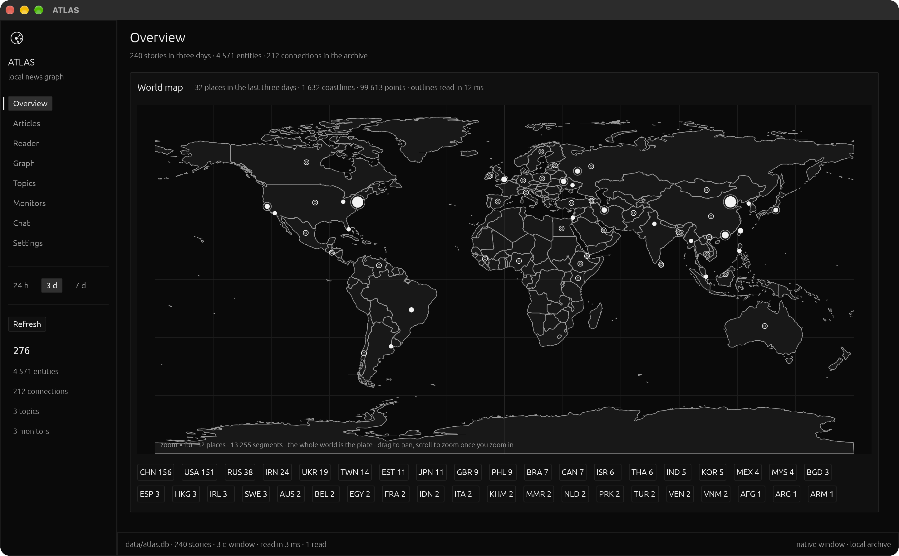

# ATLAS — fully local news intelligence



ATLAS is a news workspace that runs on one machine and talks to nothing else. A local
model decides what to search for, opens the pages it chose, reads the whole article, and
classifies it into entities, categories and tags. Every article that survives that is
stored in one SQLite archive.

You read that archive in a native window, `rust/atlas-desktop` (built and started in "Run it"
below): a world map, the stories, an entity graph, topics, monitors and a chat, drawn with
`egui` from a read-only connection to `data/atlas.db`. Nothing is served: the window binds no
port, and a test (`rust/atlas-desktop/tests/no_spawn_no_socket.rs`) keeps it that way. The app's
own reader draws a story's page in the system web view - WebKit on macOS, the Microsoft Edge
WebView2 runtime on Windows - and as text on Linux, where this build does not embed a web engine.
It starts no browser of its own (the engine is a rectangle of the window, and `wry` binds it).
The one socket it opens is outbound — a plain HTTP/1.1 request to the model
server on `127.0.0.1`, sent only when you ask the chat a question, never to a name and never off
this machine. The HTML/CSS/wasm frontend in `public/` is retired and kept only as history
(`docs/RUST-PROOF.md` §1).

Nothing is collected in the background. There is no feed, no crawler and no timer: an
article enters the archive because a model read it during a research pass you started.

## What happens to one article

1. You keep topics: a name and a few keywords. They are the requirement the model works
   from, not a filter applied afterwards.
2. A collection pass starts when the agent claims a request: a click in the window writes one
   row (`research`, `monitor_run`, `topic_add` or `enrich`) into `data/requests.db`, and
   `atlas-monitor serve` — `atlas start`'s child — claims it and runs the pass. The model calls
   `find_news` for a topic, reads the results and picks the one to three links worth opening.
3. For each link it calls `read_article`. ATLAS fetches the page over plain HTTP, with the
   gate deciding what may be opened. A page that needs JavaScript or sits behind a consent wall
   is **not** rendered: `read_article` refuses with a sentence the model can act on — "the page
   needs JavaScript and this build reads over plain HTTP only - no browser runs here, so the
   text cannot be rendered. Try another source." (`rust/atlas-ingest/src/read.rs:138`) — and the
   model picks another link. There is no browser in the shipped pipeline: a local Chrome over
   the DevTools protocol was `atlas-monitor`'s child once, and it could only be driven through a
   listening port, which this product does not open (`docs/NO-PORTS.md` §2.1).
4. The model reads the full text and calls `save_article` with its own summary, tags and
   categories, and its verdict on whether the page is reporting at all. The verdict is the
   model's judgement; no word list, publisher list or host list decides it.
5. Only then is anything written. The pipeline derives the place, the entities, the edges,
   the connections and the thread from the stored text, and the tags and categories the
   model assigned are stored beside it.

Only current reporting is kept: the ingest window is 72 hours, the default view is 72
hours, and rows older than 21 days are pruned (all three are settings).

## What the window shows

The rail on the left lists one page per view (`rust/atlas-desktop/src/app.rs`, `Page`), the
same 72-hour window by default with 24 h, 3 d and 7 d beside it, and a Refresh button. Data is
read when the page or the window changes, never per frame; the status row says how many reads
the window has done and what the last one cost.

- **Overview** — the world map, then the window's newest stories. The map is vector, not
  tiles: the vendored Natural Earth outlines (`public/vendor/ne_50m_countries.geojson`) are
  parsed once and painted as lines, so there is no tile server, no HTTP fetch and no cache to
  warm. Drag to pan, scroll to zoom.
- **Articles** — the list on the left, the reading pane on the right: title, outlet, time,
  the stored summary and the stored text, with a search box over title and body. The story's
  stored address becomes a **`Copy example.com`** button, never a link: the click puts the
  address on the clipboard and the window hands nothing to the system's URL opener, so a
  hostile row in a database file cannot ask the OS to launch `file:` or a custom scheme. The
  button is offered only when `rust/atlas-desktop/src/link.rs` accepts the address —
  `http`/`https` in lower case, printable ASCII, a host with no credentials, at most 512
  characters; anything else is shown as text.
- **Graph** — entities and the relations the archive already holds, drawn as a force layout
  (120 nodes), with a panel that says why two entities are joined ("via Jensen Huang, TSMC")
  instead of an unexplained line.
- **Topics and monitors** — read-only lists of what you saved: a monitor is a saved query
  with its cadence, last run and hits.
- **Chat** — a transcript and a composer, one question at a time, and the answer is a **loop**:
  the model is given seven read-only archive tools (`search_news`, `get_article`,
  `entity_profile`, `graph_neighbors`, `graph_path`, `timeline`, `stats`), asks for them, and
  gets their results before it answers — up to six steps (`rust/atlas-desktop/src/tools.rs`,
  `src/agent.rs`). The window has no HTTP client crate and no TLS: `src/http.rs` writes the
  request line and a JSON body to `http://127.0.0.1:<port>/v1/chat/completions` with
  `stream: true` and parses the SSE frames as they arrive, no redirect, and `endpoint` refuses
  anything that is not an `http://` address with a `127.0.0.1` literal (not even `localhost` is
  resolved). The model thinks before it answers — `enable_thinking` defaults to true and the
  reply carries the thinking in its own field, never substituted for the answer — and the page
  draws it as working, folded to one line once the answer starts. The turn runs on one thread so
  the window keeps painting; if the model server is not running, the reply says so and names the
  start script. The model server itself is never started by the window — see "Run it".

Threads and the timeline are in the archive; the window does not draw them yet. The JSON API
that once answered `/api/threads` and `/api/timeline` went with the web frontend: `atlas-web`
and `atlas-e2e` are not in this workspace any more (`ls rust` lists twenty-one crates, none of
them a listener), so nothing in the tree serves those routes.

## The promises

**Loopback only, and one write.** The window binds nothing:
`rust/atlas-desktop/tests/no_spawn_no_socket.rs` scans `src/` for a listener or a
`std::process` and fails on either, and the only address its one client can build is
`SocketAddr::from(([127, 0, 0, 1], port))` (`src/http.rs:452`) — the `llama_port` it reads from
`data/config.json`, which is the only key the window takes from that file (`src/assets.rs:101`).
Nothing in ATLAS listens: `atlas start` starts the model server (with `--host 127.0.0.1` in its
own argv), the agent and the window — and, on a machine that has never been provisioned, the
install child once before them — and no process of ours opens a port (`docs/NO-PORTS.md` is the
measurement). The one file the window may write is its intent queue,
`data/requests.db` (`src/requests.rs`); the archive stays `SQLITE_OPEN_READ_ONLY` with
`PRAGMA query_only`, and the agent, not the window, claims the rows. That file holds two
tables: `requests` (the four kinds) and `acceptance` (one row, written when you tick the
licence screen, keyed by the document version `apache-2.0+notice-2`).
`docs/OPERATIONS.md` §9 is the table, including the two numbers the config layer still carries
and nothing binds.

**Nothing is downloaded at run time.** There is no model fetch, no package manager call at
start, no update check and no telemetry. The two pieces cargo cannot build — the 6 526 302 432
byte model file and `bin/llama-server` — are provisioned once, before the app runs, by
`atlas-setup`: a separate Rust binary that no crate links, that `atlas start` runs as a child
only when one of those two pieces is missing (never on a provisioned machine), and that does
nothing without a subcommand you typed and a `--yes` you added. When a piece is missing,
`atlas-setup check` and `atlas doctor` name the path they looked in and the command that fixes
it. A first build may fetch Rust crates — that is a build step, and it says so. Nothing the
window does at run time downloads anything.

**One search engine, out of the box, and it says whose.** A research pass searches through
exactly one endpoint: the template you configured (`meta.search_engine` in the archive, or
`ATLAS_SEARCH_ENGINE` in the environment), and otherwise a built-in default —
`https://www.bing.com/news/search?q={query}&format=RSS&setmkt=en-US&setlang=en`, Bing News' RSS
feed (`rust/atlas-ingest/src/search.rs:57-63`). Every tool result names the host and whether the
engine was `"configured"` or the `"default"`, and never the substituted URL, because the
substituted URL is your question. One endpoint is not an editorial decision: it says who receives
the query, not which stories exist — that judgment stays with the model, and there is no word,
publisher or host list anywhere in the search path. A search that fails says the host and the
reason and fetches nothing else.

**100% Rust.** The product is two cargo binaries and nothing else. The face is
`rust/target/release/atlas-desktop`: one crate that is a library (fifteen modules: the frame,
the views, the queries, the projection, the gesture maths, the theme, the mark, the link gate,
the one socket, the tools, the loop, the intent queue, the installer's progress report, the
system web view and the reader that draws in it) plus
a binary of one function that opens the window — `egui`/`eframe` 0.37.0 drawing the archive
straight out of SQLite, with `rusqlite` 0.43.0 bundled, `serde_json` for the map outlines, and
`wry` 0.57.3 (macOS and Windows only) binding the operating system's web view for the reader.
No HTML, no CSS and no JavaScript of ours is needed to see the archive any more, which is why the
wasm frontend in `public/` is retired and kept only as history; the only markup the window ever
renders is the third-party page a reader asked to open. The collection side is
`rust/target/release/atlas` (`atlas start`, `atlas doctor`). There is no Python in the product
and no hand-written JavaScript. The only Python on disk is inside the vendored upstream
`tools/llama.cpp/`, which builds `bin/llama-server` and is not part of ATLAS.

**The model decides, not a list.** No fixed allowlist or blocklist of words, publishers or
hosts decides what is news or what is relevant. The search query is the model's query, the
verdict on a page is the model's verdict, and the tags are the model's tags.

## First run

Clone the repository **with its pinned `llama.cpp` submodule**:

```bash
git clone --recurse-submodules https://github.com/Michael-Glaser/news-atlas.git
cd news-atlas
```

*(If you already cloned without `--recurse-submodules`, run `git submodule update --init --recursive` once.)*

The repository holds code, not software: **it contains no model weights and no model
server binary.** Both are made on the machine that runs them, inside this folder, by a
program you start. The app itself downloads nothing, ever.

macOS

1. Double-click `ATLAS.command`.
2. It asks you to accept the licence, then downloads one file: about 6.5 GB — allow 8 GB of
   free space - from `huggingface.co` into `models/` in this folder. If the connection
   drops, or the disk fills up, it stops and says how much arrived; free some space and
   double-click it again, and it carries on from where it stopped instead of starting over.
3. The app opens at its licence screen; the full text is there, one tick, and the
   workspace opens.

Windows: the same three steps with `ATLAS.bat` (it hands off to `ATLAS.ps1`, because a
batch file cannot report a failure in a sentence). Linux: `ATLAS.sh`.

What is downloaded, exactly: **one file**,
`models/Qwen3.5-9B-Defiant-Fable-NEO-MAX-MTP-IQ4_XS.gguf`, 6 526 302 432 bytes, from the
`huggingface.co` address in `rust/atlas-setup/src/model.rs:78`. It is pinned by size *and*
by SHA-256 (`8d33af53…7637`, same file) — a download that does not match is deleted, never
opened, and both digests are printed. The model server is **compiled, not downloaded**, from
the copy of llama.cpp that ships in `tools/llama.cpp` into `bin/llama-server`; that needs
`cmake` once (`brew install cmake` / `apt install cmake` / `winget install Kitware.CMake`).
Nothing else is fetched: no account, no key, no update check, no telemetry. The search
engine is part of the app, so it needs nothing extra.

**Your own model.** If you already have a `.gguf` file, or you want a different one, name it to
the setup tool:

```
rust/target/release/atlas-setup --import-model /absolute/path/model.gguf
rust/target/release/atlas-setup --import-model https://example.org/model.gguf
```

It copies a local file (it never moves it, so yours stays where you put it) or downloads the
address with the same resumable transfer the install uses, into `models/`. Either way it checks
that the file begins with the four letters `GGUF` first: a file that does not is refused and
nothing is installed. It then writes that choice into `data/config.json` and prints the digest,
so you can pin it in `models/model.json` yourself. Restart ATLAS to load it. Nothing is
downloaded while the app runs - the window only reads what is in this folder.

You can also do it from inside the window: the Settings page lists every `.gguf` in `models/`,
offers the same `--import-model` field, prints the exact llama.cpp flags your numbers produce
(`-m`, `-c`, `-ngl`, `-t` and the rest), and sends a change to the agent as one request — the
window writes no file but its queue. `docs/OPERATIONS.md`, "The model settings", has the six
keys, their ranges and which of them `llama.cpp` actually sees.

Those three double-click files do the same four things, in this order: check that the
machine has the tools ATLAS is built with, build it from source if this copy has never been
built, run `atlas-setup --install`, and run `atlas start` — model server, agent, window
(`ATLAS.command`, `ATLAS.sh`, `ATLAS.ps1`). They print what they are doing in plain
language, and they stop with one sentence on failure instead of closing the window.

**What the window adds on that first page.** Two things, and both are the reason the window
replaced a web frontend.

*The briefing.* Overview carries a card with the local model's own sentence about what is there —
one line and up to eight facts, each ending with the story it came from — written once, stored in
the archive (`briefings`, one row per scope and window) and drawn from that row, not from a model
call per frame. Articles carries the same card for the chip, topic or monitor it is showing. The
window asks for one when it shows a scope that has stories and no row, once per scope per session
(`Atlas::asking_for_briefings`, `rust/atlas-desktop/src/app.rs:614`; the guard is
`maybe_ask_for_briefing`, `:1623`), and the agent's `brief` arm writes it. Every read of a page
then re-reads the row (`archive.briefing(scope, key, hours)`, `:759`), so a briefing that arrives
while you are looking at the page appears without a click. `docs/ARCHITECTURE.md` §9 says who
builds it, which prompt it uses, which budgets it spends and how a finished run refreshes it.

*The reader.* Every story you open offers **Read the page**, and it opens in this window: on
macOS and Windows the page is rendered by the system's own web view (WKWebView, WebView2 —
nothing is downloaded to draw it), and on Linux, where that engine is not part of the build,
the same page shows the text the archive stored, with a line saying so. The address is gated
before anything loads (`http`/`https`, no credentials, printable ASCII) and every link the page
follows passes the same gate; there are no tabs, no address bar, no devtools and no
`window.open`. The toolbar names the address the page is **on**, not the one you arrived with
(follow a link and the host changes with it), and **Close** — the first control, because the page
paints over the window — leaves it and returns you to where you came from. Leaving the Reader by
any door drops the engine view rather than hiding it; `docs/ARCHITECTURE.md` §10 says why.
Nothing about it listens on a port — the window still opens none.

`atlas-setup --install` is the whole first run in one command, and it begins with the
licence: the Apache-2.0 terms for this code, the fact that the weights and llama.cpp keep
their own terms, the absence of any warranty, and one question. Answering anything but
`yes` stops there with nothing fetched and nothing written. The answer is recorded in
`data/license.json` under the document version the app's own screen uses
(`apache-2.0+notice-2`, `rust/atlas-setup/src/license.rs`; a test fails if the two ever
drift), which is the file the window can read instead of asking a second time — until it
does, it shows the same document in full on its own screen. Running the command again is
instant: every step it finds already done is skipped.

```bash
rust/target/release/atlas-setup --install     # licence, model server, model file, done
rust/target/release/atlas-setup --install --accept-license   # same, for a script
```

It writes `data/setup.json` while it works (`phase`, `done`, `total`, `message`, `ok`), and
the window reads it: the Chat page draws the download as one sentence and a hairline
progress bar (`src/setup.rs`, the only reader; `views/chat.rs::progress_bar` cuts a rule to
the fraction, in grey).

**Nothing is downloaded at run time — not by the window, not by the monitor.**
`atlas-guard`'s audit is the evidence, and it runs offline: `there_is_exactly_one_http_client`
fails the build if any crate outside `atlas-net` (the app's filtered transport, used for news
pages during a pass you start) and `atlas-setup` (this installer, which no app binary links or
spawns — `the_install_tool_is_not_linked_into_the_app`) even names an HTTP client. The
window's only socket is outbound loopback to the model server (`src/http.rs`, one POST to
`127.0.0.1`), the monitor talks to llama.cpp the same way, and the guard audits
`atlas-desktop/tests/no_spawn_no_socket.rs` keep both of them from opening anything else. The
installer is the one place in ATLAS that fetches bytes, a person starts it, it prints the
address before it does, and it opens no port: the download is a client connection.

## What has to be on disk

| Path | What it is |
| --- | --- |
| `models/*.gguf` | the model. ATLAS loads `Qwen3.5-9B-Defiant-Fable-NEO-MAX-MTP-IQ4_XS.gguf` (6 526 302 432 bytes), fetched once by `atlas-setup --install` or placed by hand. Not in the repository (`models/*` is ignored) |
| `bin/llama-server` | the model server binary and its libraries, built from the vendored `tools/llama.cpp/` by `atlas-setup --install`. Not in the repository (`bin/` is ignored) |
| `data/atlas.db` | the archive — the only thing the window needs. Created on the first `atlas start` if it is not there; the window refuses to invent one and says so in its status row |
| `data/config.json` | your settings. Optional; defaults apply without it |
| `public/vendor/ne_50m_countries.geojson` | the country outlines the window's map draws (Natural Earth 1:50m, public domain, 3.1 MB). Read when the Overview page is first drawn; missing means an empty map, not a crash. `vendor/` is the only thing left under `public/` (`ls public` → `vendor`) |
| a Rust toolchain | only to build. The app never needs it at run time |

The page view - the part of the window that draws an article's own page - needs, per platform:

- macOS: nothing. The page view uses WebKit, which is part of macOS.
- Windows: the Microsoft Edge WebView2 runtime. `atlas-setup check` says whether it is installed;
  if it is not, install it once from Microsoft by hand (ATLAS never downloads it) and the text
  reader answers until you do.
- Linux: nothing. The page view is the text reader; the rendered page view would need WebKitGTK,
  which this build does not use, so articles open as text.

`atlas-setup check` asks the machine about every row above and answers in ten lines - the
window binary, the page view, the archive, the map outlines, the settings, the model file, which
model is served, `llama-server`, the port rule and the start command (`cargo run --offline --locked -p atlas-setup -- check`,
2026-11-22 14:24Z: `ready: the window can run on this machine.`). `atlas doctor` asks the
collection process's own eight questions instead. The two pieces cargo cannot build — the model
server and the 6 526 302 432-byte model file — are the reason `atlas-setup` exists: it is a
separate binary, no crate links it, and every step it takes needs `--yes` after printing the URL
or the argv it would use. `atlas start` runs it **once, as a child**, before anything else, on a machine where those two
pieces are missing — a second start finds them in place and spawns nothing (`--no-install` turns
even that first child off);
`docs/OPERATIONS.md` §4 is the whole story.

## Run it

The double-click files above are the easy path. Everything they do is also one command, for
people who would rather type:

```bash
rust/target/release/atlas-setup --install      # once: the model server and the model file
rust/target/release/atlas start                # the app: the model server and the window
```

The window on its own is `./run.sh` (or `run.ps1`): it builds it if it is missing and opens
it, and it starts nothing else. By hand, that is:

```bash
./run.sh                                                    # build once if needed, then the window
cargo build --release --offline --locked -p atlas-desktop    # the build it does, by hand
./rust/target/release/atlas-desktop                          # the window
```

There is no server to start first and no address to open. The window takes no arguments —
`./run.sh --help` says so — because it finds the project from its own path. It opens at
1440×900 (minimum 860×560, title `ATLAS`), reads `data/atlas.db` through one read-only SQLite
connection, binds no port and starts no process. If there is no archive it still opens and the
status row says the path it looked for.

The very first launch is a licence screen, not the archive: the notice, the Apache-2.0 text in
full, one tick, and `Accept and open ATLAS` (or `Quit`). Ticking it writes one row into
`data/requests.db` and the workspace opens; the screen returns only if that text changes
(`src/views/license.rs`, `docs/DESIGN.md` §10).

**If you want chat, start the model server separately — it is a separate process.** The window
writes the chat request itself (`src/http.rs`, one streamed HTTP/1.1 POST to
`http://127.0.0.1:<port>/v1/chat/completions`; 30 s bounds each connect, write and read, 10
minutes bounds a whole step, 8 MB caps the reply), but it never starts a process: with nothing
listening, a question comes back as a refusal. That refusal names the start script —
`./run.sh` on macOS and Linux, `run.ps1` on Windows (`http.rs:66`) — which opens this window and
starts nothing; the command that does start the model server is `atlas start` (the line below) or
the model server's own argv. `atlas start` starts `llama-server` for you (with the flags below),
plus the agent and this window. To run the model server
on its own, use the argv the launcher builds
(`rust/atlas-launcher/src/llama.rs::invocation`), filling in your model file:

```bash
./bin/llama-server -m models/<your>.gguf -c 32768 --host 127.0.0.1 --port 8080 \
  -np 1 --jinja --log-disable
```

`8080` is the `llama_port` default (`rust/atlas-config/src/spec.rs:90`) and the port the window
tries when `ATLAS_MODEL_URL` is unset; `llama_port` in `data/config.json` moves the port, and
`ATLAS_MODEL_URL` overrides the whole address. `32768` is `model_context`'s default
(`spec.rs:99`, range 1 024–262 144, `ATLAS_MODEL_CONTEXT` in the environment), which the launcher
writes into `-c` (`rust/atlas-launcher/src/llama.rs:183-187`): it is a setting, not a constant,
and `atlas-ai`'s `context::CONTEXT_TOKENS = 32768` (`rust/atlas-ai/src/context.rs:59`) is the
fallback a run uses when no window is configured. `-np 1` is one slot (`llama.rs:79`, `SLOTS`),
and the window's loop stops at six tool steps (`rust/atlas-desktop/src/tools.rs:43`, `MAX_STEPS`)
— `docs/OPERATIONS.md` §1.2 says why in full. `--log-disable` is passed unconditionally, because
the prompt carries page text and a logging server would write an article into a file.
`--no-webui` and `--mtp` are appended only when that build's `--help` advertises them, and
`--spec-type draft-mtp` replaces `--mtp` when the help names it
(`rust/atlas-launcher/src/llama.rs:217-228`). I read that function; I did not start the
server, so the flags are quoted from the code, not from a run.

### Collecting: `atlas start`

The window only reads. Articles arrive through the collection process, which builds from the same
workspace and is started by its own binary — the run scripts no longer do this:

```bash
./setup.sh             # build if needed, then the pre-flight (atlas-setup check, atlas doctor)
./setup.sh --provision # the same, plus: build bin/llama-server and fetch the pinned model
cargo build --release --offline --locked -p atlas-launcher   # once
./rust/target/release/atlas start           # model server, then the agent, then the window
./rust/target/release/atlas start --dry-run # print that plan, start nothing
./rust/target/release/atlas doctor          # what this machine has, and what it is missing
```

`atlas start` opens no port and starts no browser. It starts **up to four programs**: the
provisioning child `atlas-setup --install` (only when the model file or `bin/llama-server` is
missing, once, and it exits before the next one), `llama-server`,
`atlas-monitor serve` (the always-on agent that claims rows from `data/requests.db`) and the
window itself — then it waits for the window, and closing it is how `atlas start` ends. The
count is read from the plan `--dry-run` prints (`rust/atlas-launcher/src/plan.rs`), which is
root, provisioning, window, agent, model file, model server, "no listener", stop order.

```powershell
powershell -ExecutionPolicy Bypass -File .\setup.ps1
powershell -ExecutionPolicy Bypass -File .\setup.ps1 -Provision
powershell -ExecutionPolicy Bypass -File .\run.ps1   # the window, not the collector
```

`run.sh` and `run.ps1` are thin on purpose: they build the window when it is missing and then
exec it. Everything else is a binary's, where it is tested. `atlas start` does this, in this
order:

1. installs the stop handler, then takes the lock — on the `data/` directory first and on
   `data/atlas.lock` as the record of who holds it. One ATLAS per data directory, and a lock left
   by a dead process is reported and taken over;
2. makes `data/` and the files in it owner-only (`0700`/`0600`) and reports how many paths it
   repaired — before anything is read out of the directory;
3. loads the settings (environment, then `data/config.json`, then defaults) and validates
   them;
4. checks the loopback invariant for the one address it is responsible for: the model server's
   `127.0.0.1` literal;
5. provisions if it must: when the model file or `bin/llama-server` is missing, runs
   `atlas-setup --install` as a supervised child, once, waits for it, and stops with one
   sentence if it fails (`--no-install` skips the step and reports instead);
6. finds the model file, the window binary and the agent binary, and stops with the exact
   sentence if one is still missing;
7. starts `llama-server` as a child on loopback and waits for `/health`;
8. starts the agent, `atlas-monitor serve`, as a child — it claims `data/requests.db` and keeps
   the monitors' cadence;
9. starts the window and waits for it.

Ctrl-C (or `SIGTERM`, or closing the console on Windows — `CTRL_CLOSE_EVENT` is handled too)
stops the window, then the agent, then the model server, in that order, because the model is what
the other two work through, and nothing ATLAS did not start is signalled. The provisioning child
is never running by then: it exits before step 7.

## Checks

```bash
cd rust
cargo build --offline --locked -p atlas-desktop                             # the window builds
cargo test  --offline            -p atlas-desktop --lib                     # the crate's own unit tests
cargo test  --offline            -p atlas-desktop --test no_spawn_no_socket  # no listener, no child
cargo test  --offline --locked --workspace                                  # the whole workspace
../rust/target/release/atlas doctor                                         # 8 checks, exit 0 when ATLAS can start
```

`atlas-desktop` is a library with a thin binary: `src/lib.rs` declares the fifteen modules and every
integration test links it as `atlas_desktop::…`, so a test sees the same `pub` items the window
uses instead of re-including the files. The numbers below are from this checkout on 2026-11-22,
each one the last line of the command above it:

- `cargo build --offline --locked -p atlas-desktop` → `Finished \`dev\` profile [unoptimized +
  debuginfo] target(s) in 12.61s` (`wry` compiled in on this platform).
- `cargo test --offline --locked -p atlas-desktop --lib` → `399 passed; 0 failed; 0 ignored;
  0 measured; 0 filtered out; finished in 15.84s`. The reader, the card and the engine on their
  own: `--lib views::reader` **12 passed**, `--lib views::brief` **19 passed**, `--lib webview`
  **5 passed**.
- `cargo test --offline --locked -p atlas-guard` → the four targets a port or a dependency
  question depends on, run in one sitting: `audit_binds` `14 passed; 0 failed` (5.02s),
  `audit_downloads` `18 passed; 0 failed` (13.46s), `reachability` `12 passed; 0 failed` (5.79s),
  and `audit_manifest` **`17 passed; 1 failed`** — `the_desktop_writes_no_file` names
  `atlas-desktop/src/requests.rs:446`, where the queue file is chmodded by hand instead of
  through `atlas-platform::private`. That is a product decision in another owner's file and it
  is the one red this file knows about; `docs/NO-PORTS.md` §5 carries the same message.
- `cargo run --offline --locked -p atlas-setup -- check` → ten rows and
  `ready: the window can run on this machine.` — the transcript is in `docs/OPERATIONS.md` §5.
- **The workspace total is not quoted here.** The last one measured on this tree is from a pass
  before the web frontend was deleted, and a number about crates that no longer exist would be a
  number about nothing. The suite is green per crate where this file says so; the whole-workspace
  run is `cargo test --offline --locked --workspace --exclude atlas-bench` on a quiet tree, and
  `atlas-bench` is excluded because its debug build distorts its own timings.

None of these opens a window: they compile and run assertions, they never call
`eframe::run_native`. A run that needs a GPU surface would need a session, and this document was
written without one.

`atlas doctor` makes no network call and opens nothing: it asks the kernel about the model
server's port by *connecting* to it — a refusal is the answer "free" — and it probes a throwaway
SQLite file in `data/`. Its eight checks are the toolchain, the window binary, the model file,
`llama-server`, the loopback invariant, SQLite, that port, and the permissions on `data/`
(`rust/atlas-launcher/src/doctor/checks.rs`: `toolchain_check` … `permissions_check`). There is no
browser row and no web-asset row: the window starts neither.

There is no end-to-end harness in the tree any more. `atlas-e2e` was the one that started
`atlas-web` on an ephemeral loopback port and drove every documented route over a real socket;
it was deleted with the listener and the frontend, and `docs/API.md` is now the record of what
those routes answered rather than a description of something that runs.

## Where things live

| Path | What is there |
| --- | --- |
| `data/atlas.db` (+ `-wal`, `-shm`) | the archive: articles, FTS index, entities, edges, links, threads, topics, monitors, alerts |
| `data/config.json` | settings. The window takes one key from it — `llama_port`; the collection side also reads windows, retention and model/browser overrides. This checkout's file is `{"llama_port": 8081}` |
| `data/app.log` | written by nothing: its only writer was `atlas-web`, a crate that is not in the tree any more, so a start writes no line here. Created `0600` when `data/` is hardened, and rotated at 4 MiB (`data/app.log.1`) if anything ever writes it. What it used to hold: one line per refused or slow request — time, method, path, status, milliseconds |
| `data/llama.log` | the model server's own output, including what it says when a port is taken |
| `data/chrome.log`, `data/chrome-profile/` | **empty, and nothing shipped writes them.** They belonged to the reader browser, which no shipped binary starts any more (a local Chrome over the DevTools protocol left the pipeline on 2026-11-22, `docs/NO-PORTS.md` §2.1). The paths stay in `atlas-config`'s layout, inside `data/`, so `atlas doctor` still checks their modes |
| `data/atlas.lock` | who holds the instance lock; kept after exit as the report for the next start. `0600`, never followed if it is a symlink, and the data directory itself is locked too (POSIX; Windows cannot lock a directory, so there the file is the lock) |
| `models/`, `bin/` | the model file and the model server you provisioned |
| `public/vendor/` | the Natural Earth outlines the window's map draws; the only file tree left under `public/` |
| `public/ui/`, `public/index.html`, `public/style.css` | **deleted with the web frontend** (`ls public` → `vendor`). Nothing in the product loads them, and `rust/build-ui.sh` and `atlas-ui-tiles` went with them |
| `rust/atlas-desktop/` | the window: `src/lib.rs` (the fifteen modules), `src/main.rs` (the binary — a viewport and `run_native`, nothing else), `app.rs` (rail, pages, status row), `views/` (one page each), `data.rs` (the read-only queries), `geo.rs`/`gesture.rs` (the map's projection and gesture arithmetic), `tools.rs` (the seven archive tools and the prompt that teaches them), `agent.rs` (the loop, `MAX_STEPS = 6`), `requests.rs` (the one write: `data/requests.db`), `theme.rs` (the palette and the type ladder), `logo.rs` (the mark), `link.rs` (the one gate on a stored address), `http.rs` (the one socket), `setup.rs` (the installer's progress report, read only); `tests/` links the library |
| `rust/` | the workspace: 21 crates (including `atlas-desktop` and the install-side `atlas-setup`; no `atlas-web`, `atlas-ui`, `atlas-browser` or `atlas-e2e` any more), `Cargo.toml`, `build.sh` |
| `docs/` | the rest of the documentation, indexed in `docs/README.md` |

The archive in this checkout holds **1 439 articles**, 273 of them flagged relevant (268 of those
with body text), plus 4 557 entities, 7 510 edges, 212 article connections, 28 threads, 3 topics,
3 monitors and 17 alerts. The newest row is `2026-11-22T13:52:01Z`. Counted read-only with
`sqlite3 -readonly data/atlas.db "select count(*) …"` (14:06Z); the numbers move whenever a
research pass runs, which is why the date of the newest row is quoted with them.

## What it does not do

- No feeds and no automatic crawling. Nothing arrives while you are not asking for it.
- No cloud model, no API key, no account, and no request to anything but `127.0.0.1`.
- Nothing is downloaded or updated at run time, including the model and the browser.
- It is not a service: one person, one machine, one archive. There is no login, no user
  table and no multi-tenant anything.
- It does not decide what is true. It stores what a page said, who it named and where it
  happened, with the model's summary and tags beside it.
- The window does not write the archive. It cannot collect, classify or prune: it opens
  `data/atlas.db` read-only, so nothing you click can change a story. Its one writable file is
  `data/requests.db` — a row asking for a research pass, a monitor run, a topic, or an enrichment,
  plus the one acceptance row for the licence screen — and the process that acts on those rows is
  the agent `atlas start` runs. Collecting happens there; `atlas start` is also what starts the
  model server and the window.

## Documentation

`docs/README.md` indexes everything in `docs/`. The three to start with are
`docs/OPERATIONS.md` (the window, the model server, logs, doctor check by check, backups,
ports), `docs/ARCHITECTURE.md` (the window, the collection process, the crates, the request
path, the data flow) and `docs/RUST-PROOF.md` (why the window is Rust and what is left that is
not). `docs/API.md` is the HTTP contract of the collection process, which the window does not
use; `docs/SECURITY-PROOF.md`, `docs/THREAT-MODEL.md` and `docs/PERFORMANCE.md` are the claims,
the attacks and the measurements.

## License

Licensed under the **Apache License, Version 2.0** — see [LICENSE](LICENSE) and [NOTICE](NOTICE).
Third-party dependency licenses and attributions (including the `tools/llama.cpp` MIT submodule
and bundled Rust crates) are documented in [THIRD-PARTY.md](THIRD-PARTY.md).
